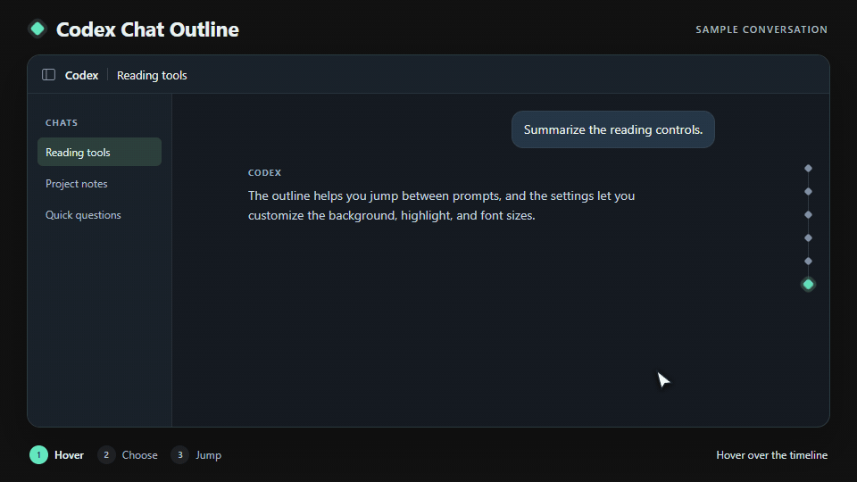

# Codex Chat Outline

[简体中文](README.zh-CN.md)

Jump back to earlier prompts in long Codex chats. Codex Chat Outline adds a searchable timeline to the right edge of the Codex Windows desktop app. Hover over the diamond markers to open the numbered outline, then select a prompt to jump to it.

[Download for Windows (ZIP)](https://github.com/Ledoras/codex-chat-outline/releases/latest/download/Codex-Chat-Outline-Windows.zip)



- See which prompt you're reading as you scroll. Use the arrow keys, Home, End, and Enter to navigate from the keyboard.
- Customize the outline's background color, opacity, and current prompt highlight. The interface supports English and Simplified Chinese and respects the system's reduced motion setting.
- Set separate font sizes for chat text, the interface, and code. Choose **Apply and save** to keep your preferences.

## Getting started

You need Windows, Codex installed from the Microsoft Store, and Node.js 22 or later available on your PATH.

1. Download and extract the entire ZIP into a folder.
2. Double-click **CodexChatOutline.exe**, open a chat with at least one prompt, and hover over the timeline on the right.

If Codex is already open without a local connection, quit it completely and run the launcher again. The launcher exits once connected, and the outline stays available while Codex is open. Run **Stop-CodexChatOutline.exe** to remove the outline and font overrides from the running client.

<details>
<summary>Build from source</summary>

Clone this repository and run the following command from the project folder.

```powershell
powershell.exe -NoProfile -ExecutionPolicy RemoteSigned -File .\Build-Launcher.ps1
```

Keep the generated executables alongside `worker.cjs`, `navigator.js`, `font-override.js`, and `integration.js`.

</details>

## Local data

The tool uses a local connection to read the prompts it needs for navigation. Preferences are stored in `%LOCALAPPDATA%\CodexChatOutline`. Chat content stays in the client and is never written to the tool's settings or sent to a server. Quitting Codex closes the local connection.
